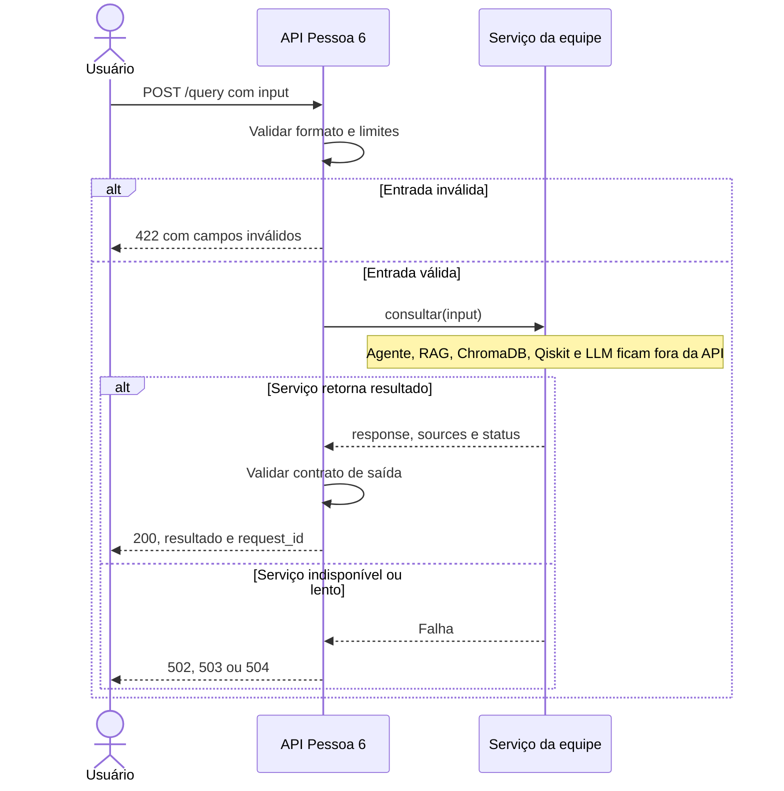
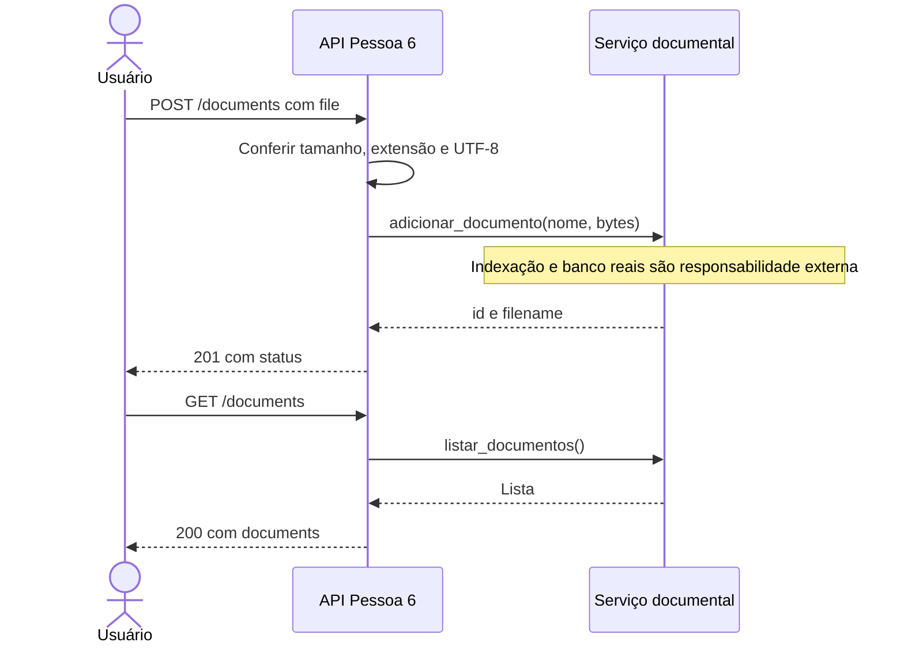
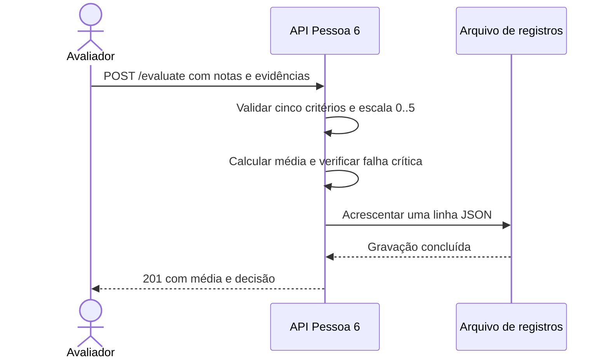

# Diagrama de sequência - API inicial

O serviço externo representa trabalho das outras frentes. A implementação inicial usa
ServicosDemo no lugar desse serviço. Não há chamada real a RAG, ChromaDB, Qiskit ou LLM.

/search usa buscar(query) no serviço externo. Sem contexto, retorna 200 com listas vazias
e status insufficient_context. Erro inesperado retorna 500 sanitizado. Falha de gravação
da avaliação não retorna sucesso.
